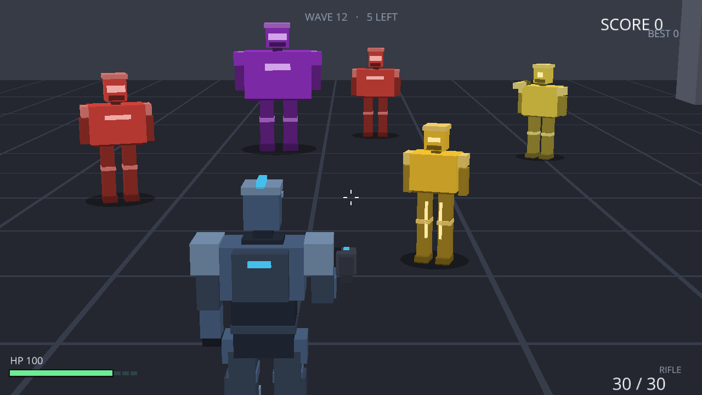
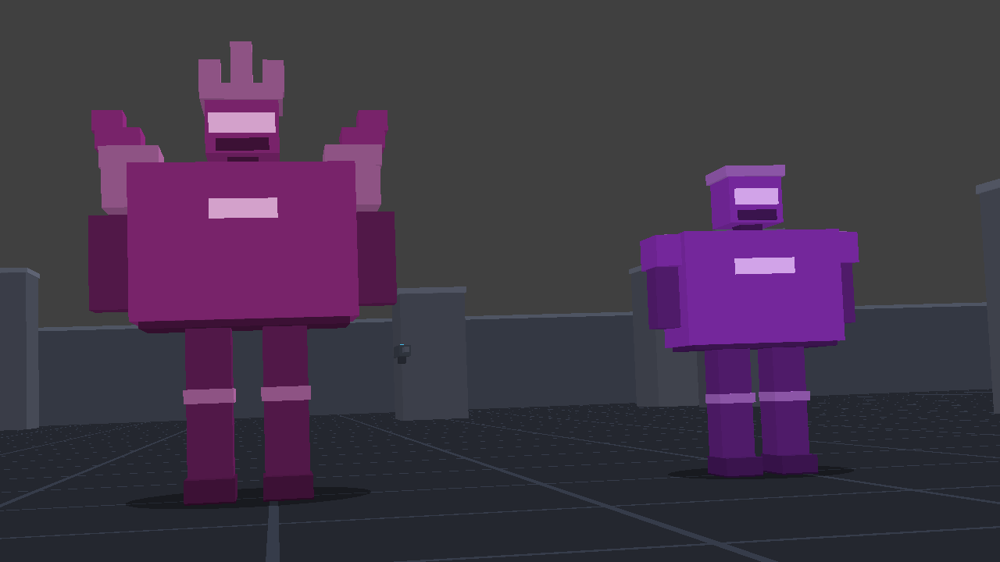
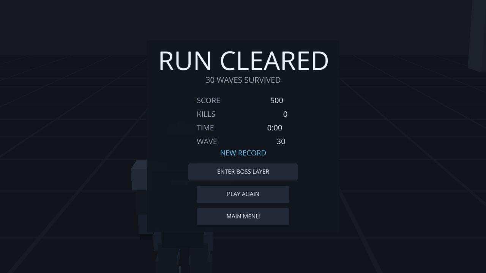

# MINI TPS

[](https://github.com/Kinen4062/shoot-3d/actions/workflows/ci.yml)
[](LICENSE)


一个用 **Ursina / Panda3D** 写的迷你第三人称射击游戏。目标是**做完整、能玩、能测**，
不是做多 —— 30 波敌人、三把枪、一个叫「Liang」的 BOSS，美术全部由方块和顶点色烘焙而成，
仓库里没有一个外部模型文件。



## 玩法

- **波次生存**：主线 30 波，清完通关；通关面板上可以再选「进 BOSS 层」打真结局。
- **三把枪**：手枪、步枪、连射霰弹枪（第 10 波解锁）。枪会随波次变强，第 20 波换大弹匣。
- **五种敌人**：普通兵、疾行者、重甲兵、远程兵，以及第 31 层的 BOSS。
- **道具与计分**：击杀掉落治疗 / 弹药 / 加速 / 宝石 / 护盾，连击有倍率，最高分写进存档。
- **程序化美术**：玩家 36 个零件、敌人 18~20 个零件烘焙成单个带顶点色的 mesh，
  同一场景的可见 draw call 从 649 压到 **75**。

## 快速开始

需要 **Python 3.12+**（Ursina 8.x 的 `Requires-Python` 就是 `>=3.12`，3.10/3.11 装不上）。

```bash
python -m venv .venv
# Windows
.venv\Scripts\activate
# macOS / Linux
source .venv/bin/activate

pip install -r requirements.txt
python main.py
```

## 操作

| 按键 | 作用 |
|------|------|
| `WASD` | 移动 |
| `Shift` | 疾跑 |
| `Space` | 闪避 |
| 鼠标 | 转视角 |
| 左键 | 开火（步枪 / 霰弹枪按住连发） |
| 右键 | 瞄准（散布收窄、镜头拉近） |
| `R` | 换弹（没拿在手上的枪会以 50% 速度自动补弹） |
| `1` / `2` / `3` | 切换手枪 / 步枪 / 霰弹枪 |
| `ESC` | 暂停（暂停面板里可调音量、回主菜单） |
| `TAB` | 循环状态机（菜单 → 对局 → 暂停 → 通关 → 结算），调试用 |
| `F1` / `F2` / `F3` | **仅开发模式**：下一波 / 清场 / 无敌（见[开发期调试](#开发期调试下一波--清场--无敌)） |

开局停在主菜单，鼠标点 **START** 进入对局。
`F1`~`F3` 默认**没有绑定任何东西** —— 要用得加环境变量启动，正式版里误触不会跳波。

## 武器

| 枪 | 单颗伤害 | 射速 | 弹匣 | 装填 | 腰射散布 | 射程 | 备注 |
|----|---------|------|------|------|---------|------|------|
| 手枪 | 25 | 0.25 s | 12 → 18 | 1.2 s | 0.25° | 60 m | 单发；纪念品，主要用来补枪 |
| 步枪 | 18 | 0.10 s | 30 → 45 | 1.8 s | 0.5° | 80 m | 连发，主力 |
| 霰弹枪 | 20 × 10 颗 | 0.5 s | 15 → 20 | 1.2 s | 2.5° | 40 m | 连发，第 10 波解锁 |

弹匣一栏的箭头是「第 20 波换大弹匣」后的数值。霰弹枪按距离分段（1 格 = 2 米）：

| 距离 | 散布 | 单颗伤害 | 一发全中 |
|------|------|----------|----------|
| ≤ 4 米（2 格） | 2.5° | 20 | **200** |
| 4~8 米 | 2.5° → 10° 线性增大 | 10 | 100 |
| ≥ 8 米（4 格） | 10° | 10 | 100，但弹着圆半径 1.4 米，实际只中一两颗 |

贴脸 DPS 约 400，是步枪的两倍多 —— 代价是必须站进 4 米，而那正好是重甲兵和 BOSS 的攻击范围。
瞄准时霰弹枪的散布只收到 0.6 倍、**不归零**：归零等于 10 颗弹丸打在同一点，
一把精度无限、单发 200 的狙击枪，距离分段的设计会整个失效。

三把枪的枪声不是同一段录音调音量：霰弹枪有自己的一条（`assets/audio/shotgun.wav`，
0.24 秒，低频更重、尾巴更长），步枪和手枪共用 `shoot.wav`（0.09 秒）。
0.5 秒一发的霰弹和 0.1 秒一发的步枪用同一声"砰"时，换枪在听觉上几乎无感。

## 局内成长

| 规则 | 数值 | 为什么 |
|------|------|--------|
| 每 5 波 | 单颗弹丸 **+1 伤** | 第 5 波 +1 …… 第 30 波 +6。固定加值而非按比例：弹丸多的枪收益更高，正好补后期最吃力的霰弹枪 |
| 第 20 波 | 弹匣 **30→45 / 12→18 / 15→20** | 后期一半时间花在换弹上，那是「烦」不是「紧张」 |

敌人血量每波 +10%（封顶 4.0 倍），所以光靠成长仍然追不上最后几波 —— 第 30 波的小兵要
10 发步枪或 1 发贴脸霰弹。成长只是让「枪不长」这件事不至于变成纯消耗战。

## 敌人

| 类型 | 血量 | 速度 | 伤害 | 攻击距离 | 攻击间隔 | 分数 |
|------|------|------|------|---------|---------|------|
| grunt 普通兵 | 60 | 3.0 | 10 近战 | 2.2 m | 1.2 s | 100 |
| runner 疾行者 | 35 | 6.0 | 8 近战 | 1.8 m | 0.7 s | 150 |
| tank 重甲兵 | 200 | 1.8 | 25 近战 | 2.6 m | 2.0 s | 300 |
| shooter 远程兵 | 45 | 2.6 | 12 弹丸 | 22 m | 2.4 s | 200 |
| **liang**（BOSS） | 1200 | 2.2 | 35 近战 + 16 炮击 | 3.2 m / 28 m | 1.6 s / 1.0 s | 3000 |

血量还要乘波次倍率：第 31 层是 4.0 倍，所以 BOSS 实际 **4800 血**，同波重甲兵是 800。

## 波次与通关

- **前 6 波**是手写节奏（`data/waves.json`），第 7 波起按公式加码：数量随波次增长，
  远程兵和疾行者按比例增加，每 6 波补重甲（第 6/12/18 波各一只，第 24/30 波两只）。
  重甲占的名额从同屏总数里扣，不会出现「排队等前面死掉才出得来」。
- 同屏上限 **30 只**，同时提供三种难度倍率：血量 +10%/波（封顶 4.0）、速度 +3%/波（封顶 1.5）。
- **第 30 波清完 = 通关**，弹出通关面板（不是死亡面板）：`RUN CLEARED`，三个按钮。
- 通关面板上可以点 **ENTER BOSS LAYER** 进入第 31 层：**2 只重甲 + 5 个远程兵 + 1 个 BOSS**。
  进 BOSS 层是这一局的延续 —— 不重开、不清场、分数保留。



BOSS 是这一层唯一的胜利条件：

- **血条**挂在屏幕顶部，只在它活着时出现。
- **炮击**：每 1 秒一发、16 伤、28 米内都打，弹丸是粉紫色（和小兵的黄球一眼分得开）。
  这套计时和近战**完全独立** —— 只做近战的话，玩家站在 3.2 米外绕圈就零威胁，
  「大号沙包」的根因就在这儿。贴脸时两套同时生效。
- **增援**：它活着时每 10 秒补 6 只杂兵（grunt 50% / runner 30% / shooter 15% / tank 5%），
  场上始终有东西要清，没法把它当成唯一目标慢慢磨。**BOSS 一死立刻停**，
  队列里还没出场的也作废 —— 否则杂兵会一直刷，通关条件永远等不到。
- 打完弹出 `LIANG DEFEATED / TRUE ENDING`。



## 项目结构

```
main.py              唯一入口：建窗口、装系统、跑主循环
src/core/            时钟、状态机、事件总线、输入路由、配置、光照、几何合并
src/entities/        玩家、敌人、子弹、道具、场地（player_body / enemy_body 是外观）
src/systems/         武器、AI、感知、生成器、波次、计分、音效、调试热键
src/ui/              HUD、菜单、准星、飘字、调试覆盖层
assets/              字体、贴图、音频（模型是代码生成的）
data/                数值表：weapons.json / enemies.json / waves.json
tests/               单元测试（500 项）
tools/               探针脚本：端到端验收、截图、费用画像
docs/                README 配图
```

## 开发

### 测试

```bash
python -m pytest
```

**500 项**，不启动窗口就能跑完（`window_type="none"`）。覆盖时钟夹取、状态机、
事件隔离、射线几何、换弹/散布/距离分段、AI 视锥与听觉、生成点规则、存档清洗、
菜单流转、几何合并的绕序与顶点色、成长曲线、BOSS 炮击与增援、调试热键的边界。

端到端另有几个探针，走的是真实的系统接线：

```bash
python tools/m5_probe.py            # 87 项：菜单 → 开局 → 暂停 → 死亡 → 重开 → 通关 → BOSS 层
python tools/m3_probe.py            # 22 项：AI / 波次 / 远程兵
python tools/_probe_shotgun.py      # 21 项：按距离逐段开火，量真实伤害与成长曲线
python tools/_probe_boss.py         # 15 项：BOSS 层阵容 / 1 秒一发炮击 / 10 秒一批增援
python tools/_probe_dev.py          # 27 项：F1/F2/F3 三个热键 + 霰弹枪专属枪声
python tools/aim_probe.py           #  4 项：屏幕中心射线
python tools/_probe_cost.py         #      draw call / 节点数 / 逻辑耗时画像
python tools/_shot_readme.py        #     重拍 README 的对局截图
```

音效和贴图是程序化生成的，删了可以重来（幂等）：

```bash
python tools/gen_sfx.py          # 11 个 wav
python tools/gen_textures.py     # 地面 2 米网格贴图
```

### 开发期调试（下一波 / 清场 / 无敌）

```bash
MINITPS_DEV=1 python main.py     # Windows CMD: set MINITPS_DEV=1 && python main.py
```

| 键 | 作用 |
|----|------|
| `F1` | 清掉当前波（含没出场的队列），立刻开始下一波 |
| `F2` | 瞬清场上所有敌人（含未出场队列），不产生击杀分 |
| `F3` | 切换无敌（伤害与护盾都不动，覆盖层显示 `god=ON`） |

只在 `PLAYING` 状态下生效 —— 暂停或结算面板上按 `F1` 不会在画面背后刷怪。
没有这个开关时连 `DevTools` 对象都不会被构造，`F1`~`F3` 没有任何落点。

三个动作都是"改状态"而不是"走玩法"：`F2` 走 `EnemySystem.clear()` 而不是逐个
`take_damage()`，所以不会掉分、不刷飘字 —— 否则"这一波该得多少分"就失去基准了。
唯一能反复验证 BOSS 层也靠它（`F1` 连按到第 31 层）。

### 静态检查与 CI

```bash
pip install -r requirements-dev.txt
python -m ruff check .     # 风格 + 疑似 bug
python -m mypy             # 类型
```

两个工具都配在 `pyproject.toml` 里，**当前是零告警**。`ruff` 开到了
`F/E/W/I/UP/B/C4/SIM/RUF/BLE`：`BLE`（盲 `except`）是有意开的 —— 这个项目要吞
Panda3D 和音频的各种异常，但每一处都得写明理由，所以代码里会看到
`except Exception:  # noqa: BLE001 - 理由`。`tools/` 整目录不参与检查：
探针必须在 `from ursina import *` 之后 import 项目模块，`E402` 是结构性的。

`mypy` 是**宽松模式**：ursina / panda3d 都没有类型标注，strict 只会逼出一堆
`type: ignore`。覆盖面是 `src/` + `main.py`。

CI（`.github/workflows/ci.yml`）三个 job，push / PR 都跑：

| job | 平台 | 跑什么 |
|-----|------|--------|
| `test` | `windows-latest` | `pytest` |
| `lint` | `ubuntu-latest` | `ruff check` |
| `types` | `ubuntu-latest` | `mypy`（故意不装 ursina，靠 `ignore_missing_imports`） |

测试放在 Windows 上跑，是因为这个项目只在 Windows 上验收 —— Panda3D 的窗口层差异
足以让测试变绿而游戏变坏。

### 日志

四档、一个环境变量切换，写错的值不炸、退回默认档：

| `MINITPS_LOG` | 你会看到 |
|---------------|----------|
| `DEBUG` | 每条生成点重采样、每次换弹（只在排查时开） |
| `INFO` | **开发期默认**。波次、重开、装载结果 |
| `WARNING` | **打包后默认**。能跑但不对劲 |
| `ERROR` | 只留「功能已经坏了」 |
| `OFF` | 全静音 |

```bash
MINITPS_LOG=DEBUG python main.py     # 一次性详细日志
python main.py                       # 默认 INFO
```

同时写一份到 `%APPDATA%\MiniTPS\log.txt`（超过 1 MB 轮转、保留 1 份备份）。
**文件打不开时只降级不抛异常** —— 只读目录、权限受限的机器照样能玩。

## 调数值

三张 JSON 表，改完直接跑，不用碰代码：

| 文件 | 内容 |
|------|------|
| `data/weapons.json` | 伤害、射速、弹匣、装填、散布、射程、解锁波次、距离分段 |
| `data/enemies.json` | 血量、速度、伤害、攻击范围与间隔、视野、分数、体型、BOSS 炮击参数 |
| `data/waves.json` | 前 6 波的手写节奏、波间休息时间、生成间隔 |

打包后 `data/` 丢了也不会崩：代码里有一份与 JSON 完全一致的兜底表，
`tests/test_enemy_ai.py` 里有一条用例专门钉住「两张表必须一致」。

## 几条不能破的规矩

1. **只有 `GameLoop` 一个 Entity 实现 `update()`**，其余系统是普通对象，由主循环按显式顺序调用。
2. **只有 `GameClock` 能读 `time.dt`**。暂停用 `clock.paused`，不要用 `application.paused`
   （它会把全局输入回调一起关掉）。
3. **不在业务代码里写按键字符串**，一律引用 `src/core/input_map.py` 的常量。
4. **不在 `src/` 里写 `print`**，用 `src/core/log.py` 的 `get_logger(模块名)`。
   `tests/test_log.py` 里有一条 AST 检查守着这条。

几个绕不开的坑（都写在代码注释里）：

- **弹道不用 `camera.forward`**。`Entity.forward` 取的是节点局部 +Z，而「屏幕中心是哪个方向」
  由投影 lens 定义，两者不一致时弹道会整体偏离准星且不报错。`src/core/screen_ray.py`
  直接对 lens 做反投影，屏幕中心与准星严格共线。
- **窗口图标必须用 `Filename.fromOsSpecific()`**，直接传字符串即使文件存在，
  Windows 窗口层也会报 `Could not find icon filename` 并退回默认图标。
- **霰弹枪的距离不能用 `hit.distance`**：射线从相机出发，而第三人称相机在玩家身后 6 米，
  4 米的目标会量成 10 米、直接掉进减半那一档。要用玩家到敌人**中心**的水平距离。

各阶段的验收清单和踩坑记录在 `M3_验收报告.md`、`M4_验收清单.md`、`M5_验收清单.md`、
`M6_验收清单.md`；想自己建模替换这套方块，从 `M6_建模指南.md` 开始。

## 已知限制

- 只做过 Windows 验收，macOS / Linux 没跑过。
- 没有打包 exe，也没有手柄支持。
- `data/waves.json` 只写了前 6 波，第 7 波起全是同一条公式 —— 想手调后期节奏得自己补。
- 美术是方块拼的，没有骨骼动画；敌人转身靠整体旋转。

## 许可

[MIT](LICENSE)
